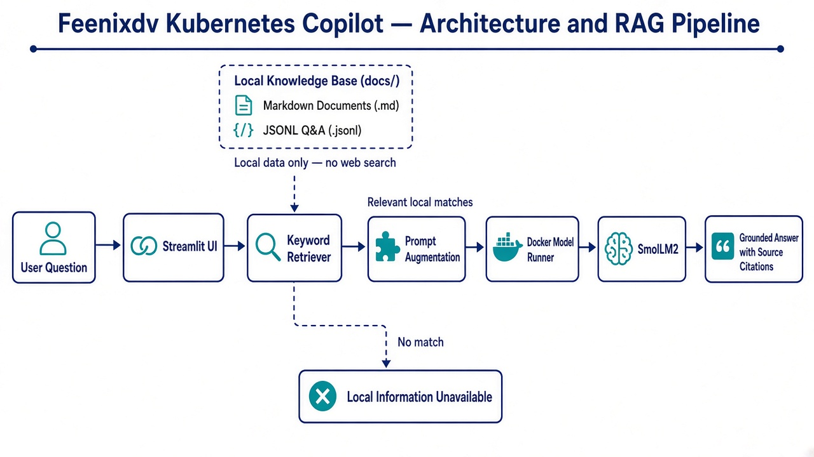

# Feenixdv Kubernetes Copilot
 
Feenixdv Kubernetes Copilot is a local Retrieval-Augmented Generation (RAG)
implementation built with Python, Streamlit, and SmolLM2. It retrieves relevant
content from a local Kubernetes knowledge base, adds that content to the prompt,
and sends the augmented prompt to SmolLM2 through Docker Model Runner.
 
Answers are grounded only in local files under `docs/`. The application does
not use web search or permit the model to fill missing information from its
general knowledge.
 
## Architecture and RAG Pipeline



The architecture runs locally. Streamlit handles user interaction and
orchestrates retrieval, while Docker Model Runner executes SmolLM2. Source
documents remain under `docs/`; no web search or external retrieval service is
used.
 
1. **Ingestion** — recursively load non-empty Markdown files from `docs/` and
   parse each valid line in `docs/k8s_qa.jsonl` as a Q&A record.
2. **Retrieval** — tokenize the user's question, ignore words shorter than
   three characters, and score each knowledge item by keyword overlap.
3. **Selection** — sort results by score and select up to three items. When
   possible, ensure that at least one Markdown document is included.
4. **Augmentation** — combine the selected source content with the user's
   question in a prompt.
5. **Grounded generation** — instruct the local `smollm2` model to answer only
   from the retrieved context, identify insufficient context, and cite the
   local source file names.

The interface shows which local sources were included. If retrieval finds no
match, it reports that the local knowledge base has no relevant information
instead of asking the model for a general-knowledge answer.
 
## Knowledge Base
 
The retriever supports two local source formats:

- Markdown (`.md`) files anywhere under `docs/`
- JSONL question-and-answer records in `docs/k8s_qa.jsonl`

`docs/kubernetes/Feenixdv_k8s_BestPractice.md` is the local Feenixdv Kubernetes
CIS and security best-practices source. It covers cluster hardening, access
control, workload security, networking, secrets, supply-chain security, and
operational checks. It is not currently a performance or resource-optimization
guide; add local performance documentation before expecting grounded answers
about speeding up clusters or tuning resource usage.

Each JSONL record must remain on one line:
 
```json
{"question":"How do I list pods?","answer":"Run kubectl get pods."}
{"question":"How do I restart a deployment?","answer":"Run kubectl rollout restart deployment <name>."}
```
 
Knowledge-base changes are loaded when Streamlit reruns the application.

## Components

- `ui/app.py` — ingestion, keyword retrieval, prompt augmentation, model
  invocation, and Streamlit UI
- `docs/` — local retrieval corpus
- Docker Model Runner — local model runtime
- `smollm2` — generation model
 
## Requirements
 
- Python 3
- Docker Desktop with Docker Model Runner available
- The `smollm2` model available to Docker Model Runner
 
## Setup
 
From the repository root, create and activate a virtual environment, then install Streamlit:
 
```bash
python3 -m venv venv
source venv/bin/activate
pip install streamlit
```
 
Check that Docker Model Runner can see and run the model:
 
```bash
docker model list
docker model inspect smollm2
docker model run smollm2 "What is Kubernetes?"
```
 
## Run
 
From the repository root:
 
```bash
streamlit run ui/app.py
```
 
Open [http://localhost:8501](http://localhost:8501) in your browser.
 
## Project Structure
 
```text
SourceCode/RAG-LLM/
├── docs/
│   ├── k8s_qa.jsonl
│   └── kubernetes/
│       ├── Feenixdv_k8s_BestPractice.md
│       ├── networking/
│       │   ├── ingress.md
│       │   └── services.md
│       └── workloads/
│           └── deployments.md
└── ui/
    └── app.py
```
 
## Example Questions
 
- How do I list pods?
- How do I restart deployment nginx?
- What service types are in the documentation?
- What Kubernetes security controls are in the knowledge base?
 
## Limitations
 
- Retrieval uses keyword overlap rather than embeddings or semantic search.
- Markdown documents are retrieved as whole files instead of smaller chunks.
- There is no vector database, reranker, conversation memory, or evaluation
  pipeline.
- JSONL validation silently skips malformed records.
- The prompt requests local-only answers, but model output should still be
  validated when accuracy matters.
- Answer quality depends on the retrieved local context and SmolLM2.
